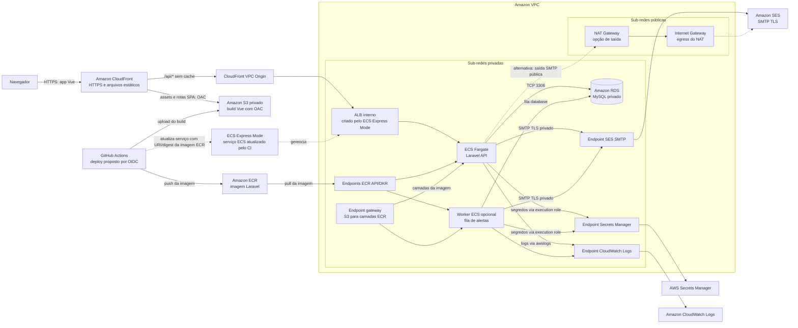

# Arquitetura AWS de referência

> **Status: proposta, não implantada.** Este documento descreve uma arquitetura possível a partir do código e das configurações atuais. Nenhum recurso AWS foi provisionado e não houve deploy.

## Escopo e premissas

A aplicação tem um frontend Vue 3/Vite compilável como arquivos estáticos e uma API Laravel 13 em Docker, com autenticação Bearer do Sanctum e banco MySQL. O cadastro cria organizações; os registros de negócio e relatórios são isolados por `organization_id`. O envio de convites usa o mailer Laravel de forma síncrona. Alertas de estoque mínimo são notificações enfileiradas após o commit da movimentação.

O workflow atual valida frontend, testes/Pint com SQLite, migrations/testes com MySQL 8.4 e build da imagem Docker. Ele não publica imagens ou assets na AWS nem executa deploy.

Para uma implantação nova, a referência usa ECS Express Mode com tarefas Fargate. A AWS informa que App Runner não aceita novos clientes e recomenda ECS Express Mode como alternativa com serviço Fargate, balanceador, TLS, escala e rede configurados pelo serviço; os recursos subjacentes são cobrados normalmente. [Disponibilidade do App Runner e recomendação de migração](https://docs.aws.amazon.com/apprunner/latest/dg/apprunner-availability-change.html), [visão geral do ECS Express Mode](https://docs.aws.amazon.com/AmazonECS/latest/developerguide/express-service-overview.html).

## Diagrama

## Componentes

| Componente | Papel no desenho | Necessidade |
| --- | --- | --- |
| Amazon S3 privado + CloudFront | Publicar o build estático de `frontend/`, entregar HTTPS e impedir acesso direto ao bucket usando Origin Access Control (OAC). A distribuição usa comportamento padrão para SPA/S3 e `/api/*` para VPC Origin; não aplicar fallback SPA nem cache às respostas da API. | Essencial para a opção estática com API privada proposta. OAC mantém o bucket privado; VPC origins permitem encaminhar CloudFront a um ALB interno em sub-rede privada. [Documentação OAC](https://docs.aws.amazon.com/AmazonCloudFront/latest/DeveloperGuide/private-content-restricting-access-to-s3.html), [VPC origins](https://docs.aws.amazon.com/AmazonCloudFront/latest/DeveloperGuide/private-content-vpc-origins.html) |
| Amazon ECR | Armazenar imagens versionadas da API produzidas pelo pipeline. | Essencial para distribuir a imagem privada ao serviço ECS. |
| Amazon ECS Express Mode + AWS Fargate | Executar a API em container. Com sub-redes privadas, o Express Mode cria um ALB interno e tarefas sem IP público; o CloudFront VPC Origin fornece a entrada pública HTTPS. Usar imagem de produção e porta coerente. | Essencial para a API em Docker desta referência. O ALB interno faz parte da integração Express Mode; o VPC Origin liga o edge público ao origin privado. Ao configurar sub-redes públicas no Express Mode, ele cria ALB internet-facing e ativa IP público nas tarefas, o que não é a topologia proposta. [Rede do ECS Express Mode](https://docs.aws.amazon.com/AmazonECS/latest/developerguide/express-service-work.html) |
| Amazon RDS for MySQL | Banco relacional persistente, privado, acessível pela API na porta 3306. | Essencial: a aplicação usa MySQL e migrations Laravel. |
| Amazon VPC e security groups | Manter o banco privado e restringir conexões: somente tarefas da API/worker alcançam MySQL; entrada web passa pelo balanceador. | Essencial para controlar tráfego entre API e banco. |
| AWS Secrets Manager | Fornecer `APP_KEY`, senha do banco e credenciais SMTP como referências secretas ao container, com permissões IAM mínimas. | Essencial para armazenar segredos fora da imagem, do Git e de texto aberto na configuração. O ECS aceita referências de Secrets Manager em variáveis do container. [Secrets em tarefas ECS](https://docs.aws.amazon.com/AmazonECS/latest/developerguide/secrets-envvar-secrets-manager.html) |
| Amazon SES | Entregar convites e, se habilitados, alertas de estoque por SMTP/TLS, compatível com a configuração atual do mailer Laravel. | Essencial para envio de e-mail na opção AWS. SES requer identidade de envio verificada; contas no sandbox só enviam para destinatários verificados até obter acesso de produção. [Identidades verificadas](https://docs.aws.amazon.com/ses/latest/dg/verify-addresses-and-domains.html), [acesso de produção](https://docs.aws.amazon.com/ses/latest/dg/request-production-access.html) |
| Amazon CloudWatch Logs | Receber logs da API e do worker, encaminhados para `stdout`/`stderr`. | Essencial para inspecionar falhas operacionais em containers efêmeros. |
| IAM | Separar permissões de execução/pull da imagem, acesso a segredos e deploy. GitHub Actions pode assumir uma role por OIDC em vez de armazenar chaves AWS duradouras. | Essencial para conceder acesso limitado aos componentes. |

## Topologia de rede e saída das tarefas

O desenho separa sub-redes públicas, usadas somente por NAT Gateways quando essa opção de egress for escolhida, de sub-redes privadas para o ALB interno criado pelo ECS Express Mode, as tarefas Fargate da API/worker e o RDS. Com sub-redes privadas, o Express Mode não cria uma entrada pública: o CloudFront VPC Origin encaminha `/api/*` àquele ALB interno. O security group do ALB permite entrada do security group gerenciado pelo CloudFront VPC Origin; o security group das tarefas permite entrada somente do ALB; o worker não precisa de entrada pública; o security group do banco permite MySQL `3306` somente dos security groups das tarefas. Endpoints de interface aceitam somente tráfego necessário das tarefas, tipicamente HTTPS `443`; para o endpoint SES SMTP, permitir somente a porta TLS escolhida, como `465` ou `587`.

Distribua as sub-redes exigidas pelo balanceador e pelo subnet group do RDS entre Availability Zones suportadas pelo ECS Express Mode e CloudFront VPC origins. O VPC Origin cria uma interface de rede gerenciada pelo CloudFront em uma sub-rede privada; a VPC também precisa de um Internet Gateway anexado, embora o tráfego do origin para a sub-rede privada não seja roteado por ele. O security group do ALB deve permitir o tráfego do security group gerenciado `CloudFront-VPCOrigins-Service-SG` na porta do listener. Essa distribuição de rede não garante alta disponibilidade por si só: quantidade mínima de tarefas e a opção Multi-AZ do banco dependem de um SLA/RTO que este projeto ainda não define. [Pré-requisitos de VPC origins](https://docs.aws.amazon.com/AmazonCloudFront/latest/DeveloperGuide/private-content-vpc-origins.html)

No CloudFront, o comportamento padrão atende assets e rotas SPA pelo S3 privado; o comportamento `/api/*` usa VPC Origin para o ALB interno, encaminha métodos, cabeçalhos necessários (incluindo `Authorization`) e query strings, e desabilita cache de respostas da API. O origin não recebe tráfego direto da internet. O VPC Origin requer região suportada e security group apropriado; valide essa integração antes de deploy. [Requisitos de VPC origins](https://docs.aws.amazon.com/AmazonCloudFront/latest/DeveloperGuide/private-content-vpc-origins.html).

Uma tarefa privada precisa alcançar dependências ao iniciar e durante a execução. O caminho pode usar VPC endpoints privados ou NAT com saída a endpoints públicos. A escolha endpoints-only evita uma rota geral à internet, mas não permite chamadas públicas não previstas; não foi identificado no código outro serviço externo obrigatório além do e-mail.

| Dependência da tarefa privada | Caminho sem NAT | Papel, porta e observações |
| --- | --- | --- |
| Pull da imagem no ECR | Endpoints de interface `ecr.api` e `ecr.dkr`, mais endpoint gateway do S3 para as camadas da imagem. | O pull ocorre pelo agente Fargate antes do container iniciar e usa a **task execution role** com permissões de leitura do ECR. Em Fargate atual, os endpoints ECR e S3 são necessários para esse caminho privado. [Endpoints ECR para Fargate](https://docs.aws.amazon.com/AmazonECR/latest/userguide/vpc-endpoints.html) |
| Leitura de segredos | Endpoint de interface Secrets Manager. | O execution role precisa de leitura somente dos segredos referenciados. Se houver chave KMS gerenciada pelo cliente, revisar permissões e o caminho KMS aplicável. [Endpoint privado do Secrets Manager](https://docs.aws.amazon.com/secretsmanager/latest/userguide/vpc-endpoint-overview.html) |
| Logs do container | Endpoint de interface CloudWatch Logs (`logs`) quando usado o driver `awslogs`. | Restringir a policy à criação de streams e envio de eventos necessários; sem endpoint ou NAT, o envio de logs falha. [Endpoint privado do CloudWatch Logs](https://docs.aws.amazon.com/AmazonCloudWatch/latest/logs/cloudwatch-logs-and-interface-VPC.html) |
| Convites e alertas por SES SMTP | Endpoint de interface SES SMTP (`email-smtp`) na mesma região e em AZ suportada. | Permite SMTP/TLS privado sem internet/NAT. O security group do endpoint permite a porta SMTP TLS somente dos security groups da API/worker. SES documenta as portas `465`, `587`, `2465` e `2587` e limitações de AZ; verificar região/AZ antes de escolher. [Endpoints VPC do SES](https://docs.aws.amazon.com/ses/latest/dg/send-email-set-up-vpc-endpoints.html) |
| Camadas da imagem no S3 | Endpoint gateway do S3 associado à route table das sub-redes privadas. | Não exige NAT e não tem cobrança adicional pelo endpoint gateway; permanecem cobranças normais aplicáveis ao S3. Esse endpoint é para camadas do ECR, não para servir o site: CloudFront acessa o bucket do frontend e o CI publica nele fora das tarefas. [Endpoint gateway S3 e preço](https://docs.aws.amazon.com/vpc/latest/privatelink/vpc-endpoints-s3.html) |

Com esses endpoints, as tarefas podem iniciar, buscar segredos, enviar logs e e-mails sem acesso genérico à internet. Policies IAM e dos endpoints continuam necessárias: conectividade de rede não concede permissão de serviço. O ECS Express Mode, a plataforma Fargate e as roles de execução devem ser configurados com sub-redes, security groups e referências de segredos compatíveis com esse caminho.

### Opções de saída e custo

1. **Somente endpoints privados:** configurar endpoints de interface ECR, Secrets Manager, Logs e SES SMTP, além do gateway S3. As sub-redes privadas não precisam de rota `0.0.0.0/0` para essas dependências. Endpoints de interface são cobrados por hora em cada AZ habilitada e por dados processados; S3 gateway não tem cobrança adicional pelo endpoint. Essa opção limita e privatiza a saída, mas vários endpoints/AZs podem custar mais que uma única rota NAT em cargas pequenas.
2. **NAT Gateway para saída pública:** a route table da sub-rede pública encaminha `0.0.0.0/0` ao Internet Gateway e a da sub-rede privada encaminha saída autorizada ao NAT Gateway; a tarefa conecta ao endpoint SMTP público regional do SES. Um NAT também pode cobrir outras chamadas públicas caso venham a existir, sem permitir conexões iniciadas da internet à tarefa. Há cobrança por hora e por dados processados/transferidos; NAT centralizado pode incluir tráfego entre AZs, enquanto distribuir NAT por AZ aumenta o custo fixo. Endpoints VPC ainda podem ser usados seletivamente para retirar tráfego AWS do NAT.
3. **Combinação:** manter ECR, Secrets Manager, CloudWatch Logs e SES em endpoints privados e habilitar NAT somente se surgir dependência pública adicional. Isso evita saída genérica no fluxo atual, mas mantém cobranças por endpoint; não criar NAT antecipadamente sem necessidade concreta.

Não são estimados valores: eles dependem da região, AZs, quantidade de endpoints, tráfego, retenção e modalidade de deploy. Consulte [preços de AWS PrivateLink](https://aws.amazon.com/privatelink/pricing/) e [preços de NAT Gateway](https://docs.aws.amazon.com/vpc/latest/userguide/nat-gateway-pricing.html) e use a calculadora com o perfil esperado. O endpoint SES SMTP é suportado, mas verificar restrições regionais/AZ é necessário para a opção sem NAT.

### Worker, fila e Redis

Convites são enviados sincronicamente durante a requisição que cria o convite; não exigem fila. Já `StockMinimumReachedNotification` implementa `ShouldQueue` e é disparada após o commit quando `LOW_STOCK_ALERT_EMAIL` está definido e uma saída cruza o mínimo. Para essa função operar, iniciar um serviço ECS worker com a mesma imagem e comando `php artisan queue:work`, configurando `QUEUE_CONNECTION=database`. As migrations já criam as tabelas de jobs.

Esse worker é condicional à ativação dos alertas. Redis não é requisito no desenho base: o `.env.example` e `config/queue.php` usam drivers database para cache, sessão e fila; Redis é habilitado pelo Compose local. Um Redis gerenciado só deve ser considerado se medições demonstrarem necessidade de cache/fila com menor latência ou maior throughput.

O envio síncrono mantém a criação de convites dependente da disponibilidade e latência do mailer. Esta arquitetura documenta esse comportamento existente; não adiciona outbox nem muda a regra de envio.

## Fluxo de requisição

1. O navegador carrega `index.html` e assets Vue pelo CloudFront. O bucket S3 permanece privado; o CloudFront acessa o origin por OAC. O fallback SPA serve `index.html` para rotas de frontend como `/accept-invitation`.
2. O build Vue recebe `VITE_API_BASE_URL` durante a compilação, apontando para a mesma distribuição CloudFront com o prefixo `/api`. Essa variável é pública no bundle e não pode conter segredos.
3. O browser envia requests para `/api/*` com `Authorization: Bearer ...`. CloudFront encaminha ao VPC Origin e ao ALB interno sem cache; como frontend e API compartilham origem, CORS não é necessário nesse caminho. Se forem expostos em origens diferentes, configure `CORS_ALLOWED_ORIGINS` com a origem exata; a API não usa cookies cross-origin (`supports_credentials=false`).
4. O ALB interno encaminha tráfego à tarefa Laravel. A aplicação autentica o token Sanctum, aplica autorização por papel e filtra consultas pela organização do usuário.
5. A API conecta ao endpoint privado do RDS pelo security group da tarefa. Para convites, o mailer envia SMTP/TLS ao SES no próprio fluxo HTTP. Alertas de estoque, se ativados, são processados pelo worker separado após a transação.

O `FRONTEND_URL` deve usar a URL pública exata do CloudFront, sem barra final; a notificação usa essa configuração para compor `/accept-invitation?token=...`. `APP_URL` e `VITE_API_BASE_URL` devem ser compatíveis com a URL pública e o prefixo `/api`, pois as respostas paginadas incluem links para páginas seguintes. Configure o behavior da API para encaminhar corretamente `Host`/`X-Forwarded-Proto` ou valide que as URLs absolutas geradas pelo Laravel continuam apontando para a distribuição pública. Não registrar query strings do caminho de aceite em logs de CDN/proxy: o token do convite é de uso único.

## Configuração e segredos

Configure valores não secretos na configuração do serviço ECS:

- `APP_ENV=production`, `APP_DEBUG=false`, `APP_URL=<URL HTTPS pública da distribuição>` e `FRONTEND_URL=<mesma URL HTTPS>`.
- `CORS_ALLOWED_ORIGINS=<origem HTTPS da distribuição>`; no desenho same-origin não há preflight CORS, mas não usar curingas se uma origem distinta for habilitada.
- `DB_CONNECTION=mysql`, host privado do RDS, porta `3306`, nome do banco e usuário dedicado de menor privilégio.
- `CACHE_STORE=database`, `SESSION_DRIVER=database` e, se houver worker, `QUEUE_CONNECTION=database`.
- `LOG_CHANNEL=stderr` e nível de log apropriado para produção, para que logs de Laravel cheguem ao CloudWatch sem depender do filesystem efêmero do container.
- `MAIL_MAILER=smtp`, host SMTP regional do SES, porta/TLS, remetente verificado e variáveis de nome/endereço configuradas.
- `VITE_API_BASE_URL=<URL HTTPS da distribuição>/api` no job que compila o frontend; o behavior `/api/*` encaminha ao VPC Origin.

Guarde `APP_KEY`, senha do banco e usuário/senha SMTP do SES em Secrets Manager. Conceda ao serviço apenas leitura desses segredos; não injete credenciais AWS estáticas. O SES SMTP exige credenciais SMTP próprias. O role de deploy do GitHub deve usar OIDC e permissões limitadas a publicar a imagem/assets e atualizar o serviço correspondente.

No deploy, use uma imagem que não contenha dependências de desenvolvimento ou valores de `.env`. A imagem atual [Dockerfile](../../Dockerfile) instala dependências de desenvolvimento e inicia `php artisan serve`; o [Compose](../../compose.yaml) também define valores de desenvolvimento e monta o código-fonte. Esses arquivos são para desenvolvimento/CI, não devem ser expostos como produção. Antes de publicar, prepare uma imagem com runtime HTTP PHP de produção, processo e porta explícitos, permissões de `storage`/`bootstrap/cache` e dependências instaladas sem `require-dev`. O health check deve consultar `/up`, já registrado pelo Laravel.

## Migrations e dados

As migrations atendem a banco vazio e a banco anterior à introdução de organizações, mas o impacto nos dados existentes é diferente:

- **Banco vazio:** as migrations criam tabelas e a tabela de organizações sem criar `Organização legada`.
- **Banco existente:** a migration de `organization_id` cria uma organização chamada `Organização legada`, associa a ela os usuários e os registros de negócio existentes e torna o campo obrigatório. Os dados permanecem, mas não são separados em organizações reais automaticamente.

Antes da atualização, tire snapshot verificável do RDS, teste a restauração e avalie volume/tamanho das tabelas e janela de manutenção. O backfill executa atualizações sobre as tabelas existentes e pode causar carga/locks conforme o volume. Rode `php artisan migrate --force` uma única vez como tarefa ECS de release/one-off com a mesma imagem e configuração da aplicação; não execute migrations automaticamente em cada réplica ao iniciar.

O rollback da migration de multitenancy remove `organization_id` e a tabela de organizações, eliminando a separação dos tenants. As verificações de duplicidade evitam falhas ao recriar índices globais, mas não preservam vínculos por organização. Em produção, reverta a imagem da aplicação mantendo o schema compatível ou aplique uma migration corretiva para frente. Só restaure snapshot conforme plano de recuperação e aceitação explícita do impacto sobre gravações posteriores; não trate `migrate:rollback` como rollback seguro de dados.

## Deploy e rollback

O workflow atual só verifica qualidade e cria um build local da imagem; não há deploy AWS configurado. Um pipeline futuro, separado desta proposta, pode autenticar o GitHub Actions via OIDC, publicar a imagem versionada no ECR e atualizar o serviço ECS Express Mode para referenciar essa imagem. A publicação do build Vue no S3 e eventual invalidação do CloudFront também partem do runner de CI. O runner GitHub-hosted acessa os serviços AWS fora da VPC da aplicação; isso não exige rota de saída nas tarefas Fargate. Se o runner for movido para dentro da VPC, a rede dele precisará de acesso aos endpoints usados por deploy, ECR e S3.

Esse pipeline poderia seguir estes passos:

1. Executar os jobs já existentes de testes SQLite/Pint, MySQL 8.4, testes do frontend e build de imagem.
2. Autenticar no AWS por OIDC, construir imagem imutável marcada com SHA do commit e publicá-la no ECR.
3. Construir `frontend/` com `VITE_API_BASE_URL` de produção e publicar os arquivos versionados no S3; invalidar/atualizar o cache de `index.html` no CloudFront.
4. Fazer snapshot/checagem do banco e rodar migrations como tarefa one-off antes da versão de API que depende do schema novo.
5. Atualizar o serviço ECS Express Mode para a nova imagem, validar `/up`, health checks e logs/erros, então observar o tráfego e os fluxos de login, cadastro, movimentação e convite.

Para rollback de aplicação, selecionar a imagem anterior no ECS e republicar a versão anterior do frontend. Preservar o banco e as migrations aditivas; quando o schema não for compatível com a versão antiga, fazer correção forward ou restaurar snapshot segundo um procedimento de recuperação testado. O ECS Express Mode suporta estratégia de deploy canário e rollback baseado em health checks/alarms quando configurado. [Atualização de serviço Express Mode](https://docs.aws.amazon.com/AmazonECS/latest/developerguide/express-service-update-full.html).

## Observabilidade

- Enviar logs estruturados da API e worker para CloudWatch Logs; não depender de arquivos locais no container.
- Acompanhar health check `/up`, tarefas reiniciadas, CPU/memória Fargate, disponibilidade dos targets e contagem de HTTP 4xx/5xx no balanceador.
- Acompanhar RDS: CPU, conexões, espaço livre, latência e estado dos backups.
- Se o worker for habilitado, observar tamanho/idade da fila `jobs` e falhas em `failed_jobs`.
- Criar alarmes para erros 5xx sustentados, tarefas sem saúde, saturação/conexões do banco e falhas de entrega de e-mail. Evitar incluir tokens, senhas ou query string de aceite de convite nos logs.

Tracing distribuído e serviço dedicado de APM não são necessários para a primeira implantação; adicionar quando métricas/logs não forem suficientes para diagnosticar latência entre API, banco e e-mail.

## Segurança

- Manter RDS sem acesso público e permitir TCP 3306 somente do security group das tarefas. Restringir tráfego das tarefas ao balanceador e às dependências necessárias.
- Usar TLS/HTTPS do browser até CloudFront. O ECS Express Mode configura um listener HTTPS `443` e certificado ACM no ALB; configure o CloudFront VPC Origin para HTTPS e valide antes do deploy que o certificado do listener corresponda ao nome usado para o origin e que o host encaminhado seja compatível. CloudFront encerra a conexão se o certificado apresentado pelo origin for inválido ou não corresponder. SMTP deve usar TLS; dados e backups do banco e objetos no S3 devem usar criptografia em repouso. [Listener e certificado do ECS Express Mode](https://docs.aws.amazon.com/AmazonECS/latest/developerguide/express-service-work.html), [requisitos HTTPS do origin CloudFront](https://docs.aws.amazon.com/AmazonCloudFront/latest/DeveloperGuide/restrict-access-to-load-balancer.html)
- Manter S3 privado com OAC, restringir roles IAM por recurso e escopo, e separar role de execução do container da role usada pelo código.
- Usar `APP_DEBUG=false`, `APP_KEY` protegida e origens CORS específicas. A URL `VITE_API_BASE_URL` é pública; nunca enviar segredo no build Vue.
- Scramble expõe `/docs/api` e `/docs/api.json` somente em ambiente local por padrão; manter o ambiente de produção definido corretamente e validar que essas rotas não são públicas.
- Tokens Sanctum não têm expiração automática nesta versão (o README registra a configuração atual `expiration = null`). Planejar política de expiração/rotação e revogação antes de operação pública de longo prazo; esta proposta não altera autenticação.
- O convite armazena hash e expira em sete dias, mas o token aparece no link de aceite. Não colocar query string em logs e manter transporte HTTPS.

## Serviços essenciais, opcionais e trade-offs de custo

### Essenciais nesta referência

CloudFront + S3, ECS Express Mode/Fargate, ECR, RDS MySQL, VPC/security groups, IAM, Secrets Manager, CloudWatch Logs e SES SMTP cobrem hospedagem, API, dados, configuração protegida, diagnóstico e entrega de convites. ECR, storage/tráfego, tarefas Fargate, balanceador, RDS, logs, segredos e a estratégia de egress têm custos associados; a conta depende de região, tamanho, tráfego, retenção, número de segredos/endpoints e tempo de execução. Fargate cobra recursos alocados, RDS cobra instância/storage/backups, NAT cobra horas e dados processados, endpoints de interface cobram horas por AZ e dados processados, e SES depende do envio/configuração. Consulte [preços Fargate](https://aws.amazon.com/fargate/pricing/), [RDS MySQL](https://aws.amazon.com/rds/mysql/pricing/), [NAT Gateway](https://docs.aws.amazon.com/vpc/latest/userguide/nat-gateway-pricing.html), [PrivateLink](https://aws.amazon.com/privatelink/pricing/), [S3](https://aws.amazon.com/s3/pricing/) e [SES](https://aws.amazon.com/ses/pricing/) e use a calculadora para região e volume reais; não há estimativa fixa neste documento.

### Opcionais, condicionados ao contexto

| Serviço/capacidade | Quando adicionar | Custo/impacto |
| --- | --- | --- |
| ECS worker + fila database | Necessário se `LOW_STOCK_ALERT_EMAIL` habilitar alertas `ShouldQueue`; não é necessário para enviar convites. | Uma tarefa Fargate contínua ou execução de worker tem custo de compute; filas database reutilizam RDS, sem Redis. |
| Domínio próprio, Route 53 e certificado ACM | Se precisar de hostname estável/branded. A distribuição CloudFront fornece a URL pública HTTPS padrão; com sub-redes privadas, o ALB do Express Mode é interno e não é um endpoint público direto. | Registro/DNS, certificados conforme configuração e gestão de nomes; atualiza `FRONTEND_URL`, `APP_URL`, `VITE_API_BASE_URL` e, se houver origens diferentes, CORS. |
| RDS Multi-AZ e mais tarefas mínimas | Se houver requisito de SLA/RTO que exija tolerância a falha de zona ou capacidade durante manutenção. O contexto não define esse SLA. | Aumenta custo de banco e compute; Multi-AZ provisiona recursos adicionais. Começar com uma instância/tarefa é mais barato, mas não oferece alta disponibilidade da aplicação. |
| Redis gerenciado | Só se perfil medido justificar cache/fila dedicado e latência/throughput maiores que o banco. | Custo fixo de instância, operação e cópias; não necessário pelo uso atual. |
| AWS WAF | Reconsiderar quando existir requisito concreto de mitigação de abuso, regras gerenciadas ou compliance. | Regras e requests adicionam custo e manutenção; não há evidência no código/contexto que o torne requisito inicial. |
| Tracing/APM dedicado | Se CloudWatch Logs e métricas não forem suficientes para localizar gargalos. | Instrumentação e ingestão adicionais; não exigido para servir o fluxo atual. |

Não há uso de upload de arquivos de negócio que exija S3 como storage da API; nesta proposta ele hospeda somente o build do frontend. Não se recomenda Redis, domínio, WAF ou alta disponibilidade como pré-requisitos sem os gatilhos descritos acima.
